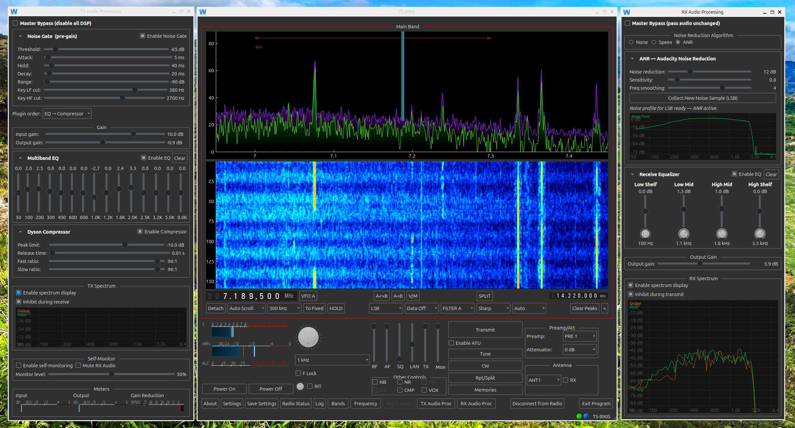
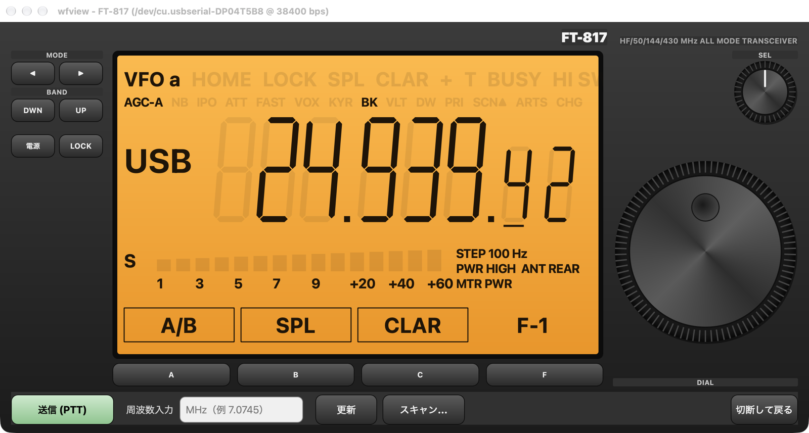
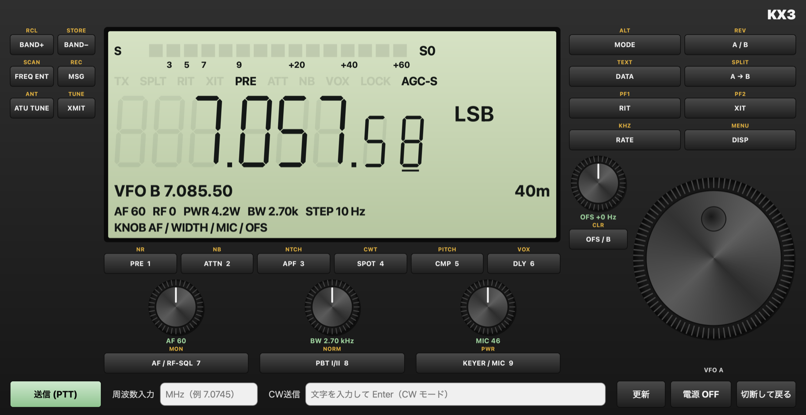

# wfview-mac

`wfview-mac` は、Icom / Kenwood / Yaesu / Elecraft などのアマチュア無線機を macOS から操作するための wfview 派生版です。
このリポジトリでは macOS 向けのアプリ名、アイコン、操作 UI、周波数操作、ウォーターフォール調整を調整しています。

元プロジェクト: [wfview](https://gitlab.com/eliggett/wfview)
公式サイト: [wfview.org](https://wfview.org/)

## この版の主な変更点

- アプリケーション名を `wfview-mac` に変更。
- macOS アプリのアイコンを wfview-iPad と同じアイコンに統一。
- 送信、TUNE、CW、Rpt/Split、Memories、Power On / Off、Split など主要操作ボタンを角丸表示に変更。
- ボタンを水色で統一し、文字を 13pt に拡大。`送信` ボタンは濃い水色の太字で表示し、送信中は `送信中` の文字を赤で表示（wfview-win から移植）。
- RF / AF / SQL などのスライダー群に `WF` スライダーを追加。ウォーターフォールの表示レベルをアプリ上から調整できます。
- 起動時に保存済みの WF レベルが反映されます。
- 周波数表示の桁をクリックすると、その桁が周波数アップ / ダウンのステップになります。
- VFO A / B 表示の横に周波数ダウン `▼` と周波数アップ `▲` ボタンを追加。
- 周波数アップ / ダウンボタンは長押しで連続操作できます。
- 周波数ロック中は周波数アップ / ダウンボタンが無効化され、誤操作を防ぎます。
- ダイアル下のステップ周波数プルダウンは非表示にし、周波数表示の桁クリックでステップを選ぶ操作に統一。
- バンド選択ボタンと周波数入力ポップアップを小型化。
- 起動時は設定画面だけを表示し、自動では接続しません。`無線機に接続` でメイン画面が最大化して開き、接続中は `切断して戻る` で切断して設定画面に戻ります。
- 設定画面に `プログラム終了` ボタンを追加。設定画面を開くたびに、選択中の接続プロファイルを読み込みます。
- 設定画面の `CI-Vアドレスを入力する` と `CI-VアドレスをモデルIDとして使用する` は、起動時から自動でチェックが入り、すぐ機種を選べます。
- 設定画面の下段のボタン（設定を保存 / 初期化する / 無線機に接続 / プログラム終了）とプロファイルの `保存` / `削除` を大きくし、文字を 14pt に拡大。終了確認のポップアップも日本語・14pt で表示します。
- Settings の `Connection Profile` で複数の接続設定を保存、選択、削除できます。
- 英語のまま残っていたボタンを日本語化し、確認ダイアログの `はい` / `いいえ` / `キャンセル` なども日本語で表示します。
- 終了時に発生していた Qt audio 系のクラッシュを回避。
- S メータの下に SWR メータ、その下に Tx(dBfs) メータ（マイク入力レベル相当）を常時表示するように変更。
- 右下の `Exit` ボタンの表示を `終了` に変更。
- `終了` ボタンは誤操作防止のためダブルクリックでのみ動作するように変更（シングルクリックでは終了しません）。
- 以下は 2026-10-22 に wfview-win から移植:
  - Settings のホスト名・ユーザー ID・パスワード欄は半角英数字だけを受け付けます（日本語入力で入った全角文字は取り除きます）。
  - モバイル回線での受信音のブツブツ音対策を追加（届いた順ではなくパケット番号順に再生、遅れて届いた音声は捨てる）。
  - 画面下の状態表示（rtt / loss / 音声の欠け）が画面外に切れないように修正。
  - Yaesu FT-817 / FT-817ND / FT-818 に対応。USB シリアル CAT ケーブルで接続すると、本体の前面パネルを模した専用画面で操作できます（周波数、モード、バンド、VFO A/B、スプリット、クラリファイア、レピーター、トーン、送信、電源など）。
  - FT-817 画面に、指定した周波数範囲のスキャン機能を追加（専用のスキャンウインドウで、ステップ周波数、信号で止まった後の再開方法、待ち時間を指定可能）。
  - FT-817 画面の `電源` で無線機の電源を OFF にすると、プログラムも終了します。
- Elecraft KX3 に対応（2026-10-22）。設定画面のメーカーに `Elecraft` を追加し、USB シリアル CAT ケーブルで接続すると、本体の前面パネルと同じ配置の専用画面で操作できます（22 個のキーと押せるつまみ 4 個の短押し・長押し、AF / RF・SQL / 帯域幅・シフト / マイク・キーヤー速度・出力、RIT / XIT、送信、CW 文字送信、電源 OFF など）。

## インストール

ビルド済みアプリを使う場合は、`wfview-mac.app` を `/Applications` に配置して起動します。

ローカルでビルドする場合は [BUILD_MACOS.md](BUILD_MACOS.md) を参照してください。
このリポジトリの現在の作業環境では、Apple Silicon 向けに `make ARCHS=arm64 -j4` でビルドしています。

## 基本操作

1. `/Applications/wfview-mac.app` を起動します。
2. `Settings` で無線機、接続方式、ポート、CI-V アドレスなどを設定します。
3. `Connect` で無線機に接続します。
4. 必要に応じて `Power On` で無線機の電源を入れます。
5. 周波数表示の桁をクリックしてステップ周波数を選択します。
6. VFO 表示横の `▼` / `▲` で、選択した桁のステップ幅だけ周波数を下げる / 上げることができます。ボタンを押したままにすると連続して変化します。
7. `送信`、`TUNE`、`CW`、`Rpt/Split`、`Memories`、`Split` などのボタンで運用操作を行います。`送信` ボタンは薄緑色で、送信中は `送信中` の文字が赤になります。

詳しい操作は [操作説明書](docs/操作説明書.md)（[PDF](docs/wfview-mac_操作説明書.pdf) / [Word](docs/wfview-mac_操作説明書.docx)）を参照してください。

## 接続プロファイル

Settings の `Connection Profile` では、接続設定を名前付きプロファイルとして複数保存できます。

- プロファイル名を入力して `Save` を押すと、現在の接続設定を保存します。
- 既存プロファイルを選択すると、保存されている接続情報が入力欄へ反映されます。
- 同じ名前で `Save` すると上書き保存します。
- `Delete` で選択中のプロファイルを削除します。
- `Connect` を押すと、選択中の保存済みプロファイルを読み込み直してから接続します。

保存対象には、メーカー、CI-V アドレス、シリアルポート、ボーレート、LAN 有効 / 無効、IP アドレス、各 LAN ポート、接続タイプ、ユーザー名、音声設定などが含まれます。

## 周波数ステップ操作

周波数表示の任意の桁をクリックすると、その桁が現在のステップ周波数になります。
例えば 100 Hz の桁をクリックした後に `▲` を押すと 100 Hz 上がり、`▼` を押すと 100 Hz 下がります。
VFO A / B 表示の横にある `▲` / `▼` ボタンを押したままにすると、選択中のステップ幅で連続してアップ / ダウンします。
周波数ロック中は `▲` / `▼` ボタンがグレーアウトし、周波数変更はできません。

従来のステップ周波数プルダウンは表示から外しています。内部状態の同期には残していますが、通常操作では周波数表示の桁クリックを使ってください。

## ウォーターフォール表示

`WF` スライダーでウォーターフォールの色レベルを調整できます。
値は保存され、次回起動時にも反映されます。

## Yaesu FT-817 / FT-817ND / FT-818

FT-817 シリーズは、本体の前面パネルを模した専用画面で操作します。USB シリアル CAT ケーブルで ACC 端子に接続してください。

（Mac 版で実機 FT-817 を接続して撮影した画面です。）

1. 設定画面でメーカーに `Yaesu`、機種に `FT-817 / 817ND (USB serial CAT)` または `FT-818 (USB serial CAT)` を選びます。
2. シリアルポート（`cu.usbserial-…` や `cu.wchusbserial…` など）と、無線機の CAT RATE と同じボーレート（4800 / 9600 / 38400）を設定し、`設定を保存` を押します。
3. 設定画面の `無線機に接続` で FT-817 画面が開きます。`切断して戻る` で設定画面に戻ります。

- 周波数はメインダイヤル、SEL つまみ、周波数の桁クリック（ステップの選択）、周波数入力欄、BAND DWN / UP（循環式）で変えられます。SSB（または 24MHz 帯以下の FM）でバンドを変えると、10MHz 未満は LSB、10MHz 以上は USB に自動で切り替わります。
- LCD 下段の A/B・SPL・CLAR などは、下の A / B / C キー、または LCD の表示を直接クリックして実行します。F でページを切り替えます。
- `スキャン...` で開くスキャンウインドウで、開始・終了周波数、ステップ、信号で止まった後の動き、待ち時間を指定してスキャンできます。
- `電源` で無線機の電源を OFF にすると、wfview も終了します。
- 無線機の電源を切れなくなったときは、バッテリー（または外部電源）を一度外してください。

詳しくは [FT-817 / FT-818 操作説明書](docs/FT-817_操作説明書.md)（[PDF](docs/FT-817_操作説明書.pdf) / [Word](docs/FT-817_操作説明書.docx)）と [CAT 配線表](docs/FT-817_CAT配線表.md) を参照してください。

## Elecraft KX3

KX3 は、本体の前面パネルと同じ配置の専用画面で操作します。USB シリアル CAT ケーブル（KXUSB または互換品）で ACC1 端子に接続してください。

（Mac 版で実機 KX3 を接続して撮影した画面です。）

1. 設定画面でメーカーに `Elecraft` を選びます（機種は `KX3 / KX2 (USB serial CAT)` に自動で決まります）。
2. シリアルポートと、無線機の RS232 メニューと同じボーレート（4800 / 9600 / 19200 / 38400）を設定し、`設定を保存` を押します。
3. 設定画面の `無線機に接続` で KX3 画面が開きます。`切断して戻る` で設定画面に戻ります。

- 前面パネルのキーは、短く押すとキーの機能、0.5 秒以上押すとキーの上の黄色い機能になります（本体のキーと同じ動作）。
- 小さなつまみは、下の押しボタンで回したときの機能が切り替わります（AF ⇔ RF/SQL、帯域幅 ⇔ シフト、マイク / キーヤー速度 ⇔ 出力、オフセット ⇔ VFO B）。
- 連続送信は 3 分で自動的に止まります。`電源 OFF` で無線機の電源を切ると、wfview も終了します。
- Prolific（PL2303 系）の互換ケーブルは、Mac App Store の PL2303Serial ドライバーが必要です。

詳しくは [KX3 操作説明書](docs/KX3_操作説明書.md)（[PDF](docs/KX3_操作説明書.pdf) / [Word](docs/KX3_操作説明書.docx)）を参照してください。

## 注意

- 実際に送信する前に、無線機、アンテナ、ダミーロード、出力設定、周波数、モードを確認してください。
- `送信` と `TUNE` は無線機を送信状態にする操作です。誤操作を避けるため、運用前に接続先とバンドを必ず確認してください。
- 無線機の機種や対応コマンドによって、一部のボタンや機能は表示されない、または無効になることがあります。

## モバイル回線で受信音が途切れる問題（2026-10-04 iPad 版で判明）

**症状:** 自宅の wfview サーバー（IC-7300）へモバイル回線（テザリングを含む）で接続すると、受信音がひどく途切れる。家の LAN では起きない。iPad 版で起き、iPhone 版では起きなかった。mac 版も同じ通信のしくみなので、同じ条件なら同じことが起きる。

**原因:** 音声コーデックの設定。`LPCM 1ch 16bit`（48kHz）だと起き、`Opus 1ch` だと起きない。

- LPCM は圧縮しないので、20ms ごとに 1920 バイトの音声データが出る。サーバーはこれを最大 1364 バイトずつに分けて送るため（`src/radio/icomserver.cpp` の `receiveAudioData()`）、1364 バイトの大きいパケットと 556 バイトの小さいパケットが交互に流れる。
- 大きいパケットは UDP/IP のヘッダを含めると 1400 バイトを超え、モバイル回線の経路の上限（MTU）を超えて捨てられていた。iPad 版のログでは奇数番号のパケットがひとつも届かず、再送を求めても届かなかった（`No response for missing packet` が数千回）。
- 結果として届く音声は全体の 3 割ほどになり、途切れて聞こえていた。
- Opus は圧縮されるのでパケットが小さく、モバイル回線でもすべて届く。

**対処:** 設定画面で受信・送信のコーデックを両方 `Opus 1ch` にする（Opus は wfview サーバーに接続したときだけ使える）。送信も同じ大きさで分けて送るので、送信側も Opus にしておく。iPhone 版・iPad 版は受信遅延 500ms、送信遅延 303ms で使っている。2026-10-04 から mac 版の初期値を `Opus 1ch` に変更した（`src/wfmain.cpp` の `setDefPrefs()`）。ただし、すでに保存されている設定や接続プロファイルはそのまま使われるので、以前から使っている場合は設定画面で変更する。wfview 以外（無線機本体の LAN など）に接続したときは、自動で LPCM 16bit に切り替わる。

**補足:** `src/radio/icomudpaudio.cpp` には「Icom のパケット番号は 2 ずつ進む」というコメントがあるが、これは誤り。サーバーはパケット番号を 1 ずつ進める。2 ずつに見えたのは、大きいパケットがモバイル回線で抜けていたため。iPhone 版・iPad 版と同じ実装にそろえるため、コードは直していない。

## 関連ドキュメント

- [操作説明書](docs/操作説明書.md)（[PDF](docs/wfview-mac_操作説明書.pdf) / [Word](docs/wfview-mac_操作説明書.docx)）
- [FT-817 / FT-818 操作説明書](docs/FT-817_操作説明書.md)（[PDF](docs/FT-817_操作説明書.pdf) / [Word](docs/FT-817_操作説明書.docx)）
- [FT-817 / FT-818 CAT 配線表](docs/FT-817_CAT配線表.md)
- [KX3 操作説明書](docs/KX3_操作説明書.md)（[PDF](docs/KX3_操作説明書.pdf) / [Word](docs/KX3_操作説明書.docx)）
- [macOS ビルドガイド](BUILD_MACOS.md)
- [インストール情報](INSTALL.md)
- [wfserver 情報](WFSERVER.md)

## ライセンス

wfview は 2017-2026 Elliott H. Liggett (W6EL) および Phil Taylor (M0VSE) による著作物です。
ソースコードは GNU GPLv3 ライセンスで提供されています。

## クレジット

このリポジトリは wfview プロジェクトを元にしています。
QCustomPlot、PortAudio、RtAudio、Speex、Opus、Hamlib 由来コード、Audacity Noise Reduction 由来コードなど、元プロジェクトで利用されている各ライブラリと貢献者に謝意を表します。詳細は元 wfview プロジェクトのドキュメントとソース内の著作権表記を参照してください。
