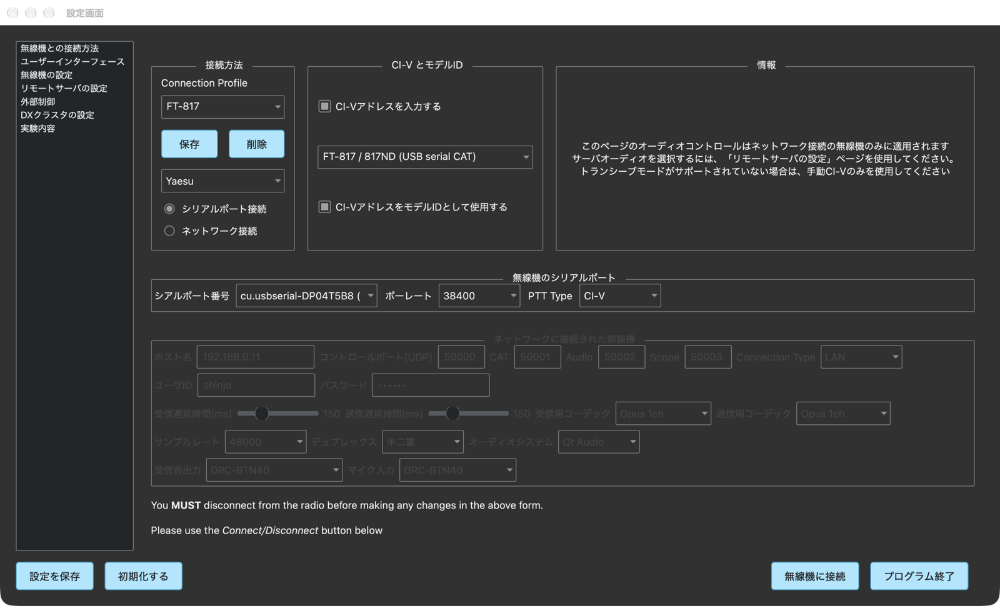
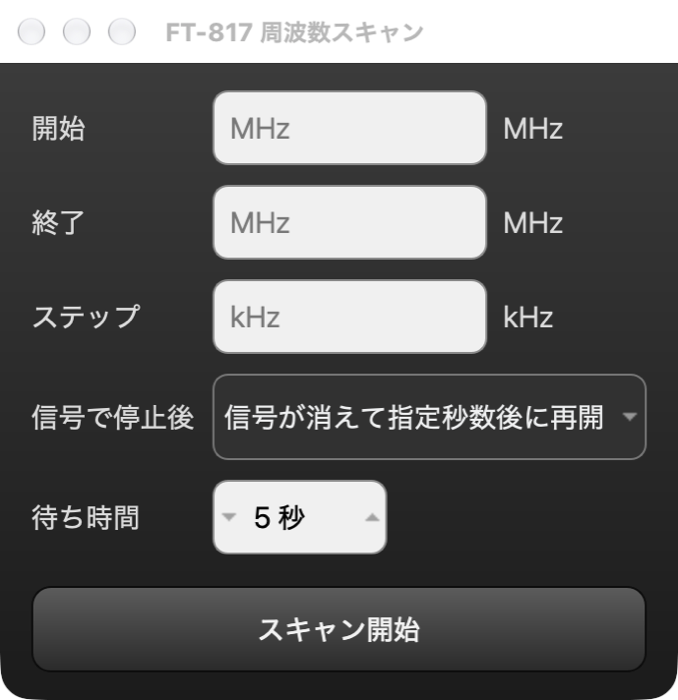

# wfview-mac FT-817 / FT-818 操作説明書

更新日: 2026-10-22（wfview-mac、実機 FT-817 を接続して画面を撮影）

## 1. 概要

wfview-mac は、Yaesu FT-817 / FT-817ND / FT-818 を USB シリアル CAT ケーブルで Mac につなぎ、本体の前面パネルを模した専用画面（以下「FT-817 画面」）で操作できます。

FT-817 画面でできること:

- 周波数の変更（メインダイヤル、SEL つまみ、周波数の桁クリック、周波数入力欄、BAND DWN / UP）
- モードの切り替え（LSB / USB / CW / CWR / AM / FM / DIG / PKT）
- VFO A / B の切り替え、スプリット、クラリファイア
- レピーターシフト、トーン（TONE / TSQ / DCS）、CTCSS トーン・DCS コード・シフト幅の設定
- 送信（PTT）と受信の切り替え
- パネルロック、電源 ON / OFF
- 指定した周波数範囲のスキャン（専用のスキャンウインドウ）
- S メーター、送信時のメーター、各種表示（AGC、NB、IPO、ATT、VOX など）の表示

FT-817 は CAT で受信音や送信音を送れないため、音声は無線機のスピーカー・マイク（またはヘッドホン端子など）を使います。

## 2. 準備

### 2.1 必要なもの

- FT-817 / FT-817ND / FT-818 本体
- USB シリアル CAT ケーブル（ACC 端子用）。配線は [FT-817 / FT-818 CAT 配線表](FT-817_CAT配線表.md) を参照してください。
- wfview-mac をインストールした Mac

CH340 チップや FTDI チップのケーブルは、macOS 標準のドライバーで認識されます。ケーブルを挿すと、`/dev/cu.usbserial-…` や `/dev/cu.wchusbserial…` という名前のシリアルポートが現れます。

### 2.2 無線機側の設定

1. FT-817 のメニュー **CAT RATE** で通信速度を選びます（4800 / 9600 / 38400 bps）。38400 bps をおすすめします。
2. 通常は他の CAT 関連の設定を変える必要はありません。

## 3. 接続

### 3.1 起動すると設定画面が開きます

wfview-mac を起動すると、最初は設定画面だけが開きます。起動しただけでは無線機に接続しません。

### 3.2 接続の設定

設定画面の左のリストで「無線機との接続方法」を選び、次のように設定します。

| 項目 | 設定内容 |
|---|---|
| メーカー（接続方法欄のプルダウン） | `Yaesu` |
| 接続方式 | `シリアルポート接続` |
| CI-V とモデルID の機種欄 | `FT-817 / 817ND (USB serial CAT)` または `FT-818 (USB serial CAT)` |
| シリアルポート番号 | CAT ケーブルのポート（例: `cu.usbserial-DP04T5B8`） |
| ボーレート | 無線機の CAT RATE と同じ値（4800 / 9600 / 38400） |
| PTT Type | そのままでかまいません（FT-817 画面では CAT コマンドで送信します） |

- `CI-Vアドレスを入力する` と `CI-VアドレスをモデルIDとして使用する` は、起動時から自動でチェックが入っています。チェックが入っていれば機種の欄から選べます。
- 機種の欄の候補は、メーカーを `Yaesu` にすると FT-710 / FTX-1 / FT-817 / FT-818 になります。

### 3.3 接続プロファイルに保存する

`Connection Profile` の欄に名前（例: `FT-817`）を入れて `保存` を押すと、上の設定を名前を付けて保存できます。次回からは一覧で選ぶだけで設定が読み込まれます。

- 設定画面を開くたびに、選択中のプロファイルの内容が読み込まれます（無線機に接続中は読み込みません）。
- 不要になったプロファイルは、選んで `削除` を押します。
- 画面下の `設定を保存` を押すと、その他の設定も含めて保存されます。

### 3.4 無線機に接続する

1. FT-817 の電源を入れます（電源が切れていても、FT-817 画面の `電源` で入れられます）。
2. 設定画面の右下にある `無線機に接続` を押します。
3. FT-817 画面が開き、LCD に周波数とモードが表示されれば通信できています。

ウインドウのタイトルには、使っているポートと通信速度が表示されます（例: `wfview - FT-817 (/dev/cu.usbserial-DP04T5B8 @ 38400 bps)`）。

LCD に「ポート未接続」や「CAT 応答待ち（電源・ボーレート・ケーブルを確認）」と出る場合は、[8. トラブルシューティング](#8-トラブルシューティング) を見てください。

### 3.5 切断して設定画面に戻る

FT-817 画面の右下にある `切断して戻る` を押すと、無線機から切断して FT-817 画面を閉じ、設定画面に戻ります。設定を変えて、もう一度 `無線機に接続` で接続し直せます。

FT-817 画面をウインドウの閉じるボタンで閉じた場合も、送信を止めてからシリアルポートを閉じます。

## 4. FT-817 画面の各部

### 4.1 全体の配置

| 場所 | 部品 |
|---|---|
| 左側 | MODE `◀` / `▶`、BAND `DWN` / `UP`、`電源`、`LOCK` |
| 中央 | LCD（周波数・モード・各種表示・S メーター・ファンクション表示） |
| LCD の下 | `A` / `B` / `C` / `F` キー |
| 右上 | SEL つまみ |
| 右側 | メインダイヤル（DIAL） |
| 最下段 | `送信 (PTT)`、周波数入力欄、`更新`、`スキャン...`、`切断して戻る` |

### 4.2 LCD の表示

| 表示 | 内容 |
|---|---|
| `VFO a` / `VFO b` | 使用中の VFO |
| 上段の表示（HOME / LOCK / SPL / CLAR / + / − / T / BUSY / HI SWR など） | 点灯しているものが有効な状態です。BUSY はスケルチが開いているとき点灯します |
| 2 段目の表示（AGC / NB / IPO / ATT / FAST / VOX / KYR / BK / VLT / DW / PRI / SCN / ARTS / CHG など） | 本体の設定状態を表示します（本体のメモリーから読み取ります） |
| モード（大きな文字） | LSB / USB / CW / CWR / AM / FM / FM-N / DIG / PKT |
| 周波数 | 10 Hz の桁まで表示します。下線の付いた桁が、ダイヤル 1 目盛りの変化量（ステップ）です |
| S メーター | 受信中は信号の強さ（S1〜S9、+20〜+60）を表示します。送信中は本体で選んだメーター（PWR / ALC / SWR / MOD）の値になります |
| `STEP` | ダイヤル 1 目盛りで変わる周波数 |
| `PWR` / `ANT` / `MTR` | 送信出力、使用アンテナ端子（FRONT / REAR）、メーターの種類 |
| 最下段の枠（例: `A/B` `SPL` `CLAR` `F-1`） | A / B / C キーに割り当てられている機能と、ページ番号（F-1〜F-3） |

## 5. 操作

### 5.1 周波数を変える

| 方法 | 操作 |
|---|---|
| メインダイヤル（DIAL） | ドラッグして回す、マウスホイールを回す、右半分をクリックで 1 ステップ上、左半分をクリックで 1 ステップ下 |
| 周波数の桁クリック | LCD の周波数の桁をクリックすると、その桁がダイヤルのステップになります（例: 100 Hz の桁 → 100 Hz ステップ） |
| SEL つまみ | 1 目盛りで 100 kHz 変わります。CLAR が ON のときは、クラリファイアのずれ量を 10 Hz ずつ変えます |
| 周波数入力欄 | 最下段の `周波数入力` に MHz 単位で入力して Enter（例: `7.0745`）。範囲外の値は受け付けません |
| BAND `DWN` / `UP` | 次のバンドへ移ります（循環式。430MHz 帯の次は 1.9MHz 帯） |

BAND `DWN` / `UP` で移る周波数は次のとおりです。

1.9 / 3.55 / 7.1 / 10.12 / 14.2 / 18.1 / 21.2 / 24.93 / 28.5 / 50.2 / 145.0 / 433.0 MHz

バンドを変えたとき、モードが SSB（または 24MHz 帯以下へ移るときの FM）なら、10MHz 未満は LSB、10MHz 以上は USB に自動で切り替わります。CW・AM・DIG などはそのままです。

### 5.2 モードを変える

MODE `◀` / `▶` で、LSB → USB → CW → CWR → AM → FM → DIG → PKT の順に切り替わります（両端で反対側へ戻ります）。

FM のナロー（FM-N）は、F-3 ページの `NAR` で切り替えます（FM モードのときだけ）。

### 5.3 A / B / C / F キー（ファンクション）

LCD の下の `A` / `B` / `C` キーには、LCD の最下段に表示された機能が割り当てられています。`F` を押すとページ（F-1 → F-2 → F-3）が切り替わります。LCD 最下段の枠を直接クリックしても、同じ機能を実行できます。

| ページ | A | B | C |
|---|---|---|---|
| F-1 | `A/B`（VFO A / B の切り替え） | `SPL`（スプリット ON / OFF） | `CLAR`（クラリファイア ON / OFF） |
| F-2 | `RPT`（レピーターシフト） | `TON`（トーンの種類） | `SET`（設定ダイアログ） |
| F-3 | `NAR`（FM ナロー） | `STEP`（ダイヤルのステップ） | （なし） |

- **RPT**: 押すたびに シンプレックス → −シフト → ＋シフト → シンプレックス と切り替わります。
- **TON**: 押すたびに OFF → TONE（エンコーダー）→ TSQ（トーンスケルチ）→ DCS → OFF と切り替わります。
- **SET**: 「FT-817/818 設定 (CAT)」ダイアログを開き、CTCSS トーン、DCS コード、レピーターのシフト幅、CLAR のずれ量を設定します。
- **STEP**: 押すたびにダイヤルのステップが 10 Hz → 100 Hz → 1 kHz → 2.5 kHz → 5 kHz → 10 kHz → 12.5 kHz → 25 kHz → 100 kHz と変わります。

### 5.4 送信する

最下段の `送信 (PTT)` を押すと送信し、ボタンが赤い `受信に戻す` に変わります。もう一度押すと受信に戻ります。

- 安全のため、連続送信は 3 分で自動的に止まります。
- 送信を始めると、スキャン中ならスキャンを止めます。
- 送信する前に、周波数・モード・出力・アンテナ（またはダミーロード）を必ず確認してください。

### 5.5 パネルロック

`LOCK` を押すと本体のパネルロックが ON / OFF になります。ロック中は、本体側で周波数の変更が拒否される場合があります。

### 5.6 電源

- 無線機の電源が切れているときに `電源` を押すと、電源 ON のコマンドを送ります。
- 電源が入っているときに `電源` を押すと「無線機の電源を OFF にして、プログラムを終了しますか？」と確認が出ます。`はい` を押すと、無線機の電源を切ってから wfview-mac も終了します。設定を保存していない場合は、終了前に保存するかどうか聞かれます。
- 電源を CAT で切れなくなったときは、無線機のバッテリー（または外部電源）を一度外してください。

### 5.7 表示を更新する

無線機本体のつまみやメニューで設定を変えたときは、最下段の `更新` を押すと、本体の状態をすべて読み直して表示を合わせます（周波数とモードは常に自動で読み直しています）。

## 6. 周波数スキャン

最下段の `スキャン...` を押すと、スキャンウインドウが FT-817 画面の右隣に開きます。指定した周波数範囲をステップごとに受信し、スケルチが開いた（信号があった）ところで止まります。

### 6.1 設定項目

| 項目 | 内容 |
|---|---|
| 開始 | スキャンを始める周波数（MHz） |
| 終了 | スキャンを終える周波数（MHz）。開始より大きい値にします |
| ステップ | 1 回に進む幅（kHz、0.01 kHz 単位、範囲の幅以下） |
| 信号で停止後 | 信号で止まった後の動き（下の表） |
| 待ち時間 | 再開までの秒数（1〜60 秒） |

| 信号で停止後 | 動き |
|---|---|
| 指定秒数後に再開 | 止まってから「待ち時間」がたつと、信号があってもスキャンを再開します |
| 信号が消えて指定秒数後に再開 | 信号が消えてから「待ち時間」がたつとスキャンを再開します |
| 停止したまま | 信号を見つけたところでスキャンを終了します |

`スキャン開始` を押したときの設定が保存され、次回 wfview-mac を起動したときにも残っています。

### 6.2 スキャンの手順

1. 無線機のスケルチ（SQL）を、雑音でスケルチが開かない位置に合わせます。スキャンはスケルチが開いたかどうかで信号を判断します。
2. 開始・終了・ステップ・停止後の動き・待ち時間を入力します。
3. `スキャン開始` を押します。終了の周波数まで進むと、開始の周波数へ戻って続けます。
4. スキャン中は、ボタンが `スキャン停止` になり、FT-817 画面の `スキャン...` が琥珀色の `スキャン中...` になります。
5. 止めるときは `スキャン停止` を押します。

### 6.3 スキャンが止まる条件

- `スキャン停止` を押したとき
- 手で周波数を変えたとき（ダイヤル、SEL、桁、入力欄、BAND など）
- 送信を始めたとき
- 「停止したまま」で信号を見つけたとき
- シリアル接続が切れたとき
- FT-817 画面を閉じたとき（`切断して戻る` を含む。スキャンウインドウも一緒に閉じます）

スキャンウインドウだけを閉じても、スキャンは続きます。`スキャン中...` を押すと、スキャンウインドウがもう一度開きます。

## 7. 終了

- FT-817 画面の `電源` で無線機の電源を切ると、wfview-mac も終了します。
- 無線機の電源を入れたまま終了するときは、`切断して戻る` で設定画面に戻り、`プログラム終了` を押します。
- 終了するときは「プログラムを終了しますか？」と確認が出ます。設定を保存していないときは「設定が保存されていません。このまま終了しますか？」と出るので、`保存` を押すと保存してから終了します。

## 8. トラブルシューティング

| 症状 | 確認すること |
|---|---|
| 機種の欄で FT-817 を選べない | メーカーが `Yaesu` になっているか、`CI-Vアドレスを入力する` にチェックが入っているか確認します |
| シリアルポートの一覧にケーブルが出ない | ケーブルを挿し直します。別の USB 端子やハブを試します |
| LCD に「ポート未接続」と出る | シリアルポートの選択を確認します。他のアプリがそのポートを使っていないか確認します |
| LCD に「CAT 応答待ち」と出る | 無線機の電源、ボーレート（CAT RATE と同じか）、ケーブルの配線（TXD と RXD が逆になっていないか）を確認します |
| 周波数が変わらない | `LOCK` が ON になっていないか確認します |
| `NAR` が効かない | FM モード以外では CAT から切り替えられません |
| スキャンがすぐ止まる・止まらない | 無線機のスケルチの位置を調整します |
| 電源を切れない・反応しない | 無線機のバッテリー（または外部電源）を一度外し、入れ直してから電源を入れます |

動作の記録は、Mac の一時フォルダの `wfview-日時.log` に書き出されます（FT-817 画面のメッセージは `FT-817/818:` で始まります）。

## 9. 安全上の注意

このアプリは無線機を送信状態にできます。送信、レピーター・トーン設定、スプリットを操作する前に、周波数、出力、アンテナ、免許の条件、周囲への影響を必ず確認してください。
