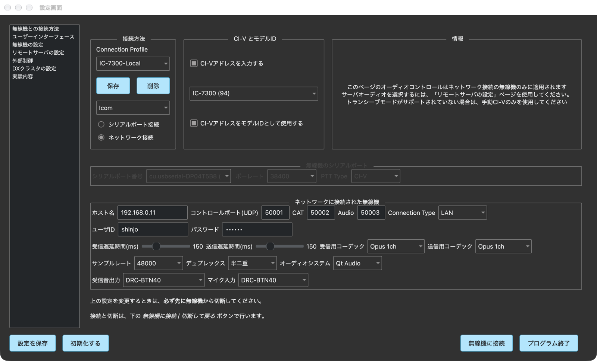

# wfview-mac 操作説明書

更新日: 2026-10-22（起動時は設定画面だけを表示 / 切断して戻る / プログラム終了 / CI-V 欄の初期チェック / ボタンの日本語化・大型化 / FT-817 スキャンウインドウ）

## 1. 概要

`wfview-mac` は、macOS から対応無線機を制御するためのアプリケーションです。
周波数、VFO、送受信、チューナー、CW、レピータ / スプリット、メモリー、スペクトラム / ウォーターフォール表示を操作できます。

この操作説明書では、このリポジトリの macOS 版で追加・調整された操作を中心に説明します。
左側の目次をクリックすると、該当する説明へジャンプできます。

Yaesu FT-817 / FT-817ND / FT-818 は専用の画面で操作します。詳しくは [FT-817 / FT-818 操作説明書](FT-817_操作説明書.md)（PDF 版: FT-817_操作説明書.pdf）と [FT-817 / FT-818 CAT 配線表](FT-817_CAT配線表.md) を参照してください。FT-817 画面の `電源` で無線機の電源を OFF にすると、プログラムも終了します。

## 2. 起動と接続

### 2.1 接続までの基本手順

1. `/Applications/wfview-mac.app` を起動します。起動時は**設定画面だけ**が開きます。起動しただけでは無線機に接続しません。
2. 設定画面で、メーカー、接続方式、機種（CI-V アドレス）、ポート、音声入出力などを設定します。接続プロファイルを保存してあれば、一覧から選ぶだけです。
3. 設定画面の右下の `無線機に接続` を押すと、メイン画面が最大化して開き、無線機に接続します（FT-817 / FT-818 を選んでいる場合は FT-817 画面が開きます）。
4. 無線機がリモート電源制御に対応している場合は、`電源ON` で電源を入れます。
5. 終了時は必要に応じて `電源OFF` を押してから、メイン画面の `終了` をダブルクリックするか、設定画面の `プログラム終了` を押します。

接続中は、メイン画面の `無線機に接続` ボタンが `切断して戻る` に変わります。押すと無線機から切断し、メイン画面を閉じて設定画面に戻ります。

設定画面の下の段のボタン:

| ボタン | 用途 |
|---|---|
| `設定を保存` | 設定画面の内容を保存します。 |
| `初期化する` | 設定を初期値に戻します（確認が出ます）。 |
| `無線機に接続` | 画面に表示されている設定で無線機に接続します。 |
| `プログラム終了` | wfview-mac を終了します（終了の確認が出ます）。 |

接続後、無線機の対応機能に応じてボタンや設定項目が有効になります。対応していない機能は非表示または無効になります。

### 2.2 接続プロファイル

設定画面の `Connection Profile` では、無線機ごとの接続設定を名前付きプロファイルとして複数保存できます。
自宅 LAN、リモート接続、USB シリアル接続などを切り替える場合に使用します。

- プロファイル名を入力して `保存` を押すと、現在の接続設定を保存します。
- 既存プロファイルを選択すると、保存されている接続情報が入力欄へ読み込まれます。
- 設定画面が開くたびに、選択中のプロファイルの内容を読み込みます（無線機に接続中は読み込みません）。
- 同じ名前で `保存` を押すと、そのプロファイルを上書きします。
- `削除` を押すと、選択中のプロファイルを削除します。

保存される主な項目: メーカー、CI-V アドレス、PTT 種別、シリアルポート、ボーレート、
LAN 有効 / 無効、IP アドレス、Control / CAT / Audio ポート、接続タイプ、ユーザー名、パスワード、
音声入出力、サンプルレート、コーデック、レイテンシ。

注意:

- プロファイルを選択しただけでは接続しません。接続するには `無線機に接続` を押します。
- 入力欄を修正した内容は接続にそのまま使われますが、次回のために残すには `保存` で保存してください。
- パスワードはプロファイルに保存されます。共有 PC では取り扱いに注意してください。

### 2.3 メーカーの選択

設定画面のメーカー欄（Icom / Kenwood / Yaesu）を切り替えると、そのメーカーの既定ポートに
自動リセットされ、CI-V アドレスのプルダウン内容も切り替わります。
意図せず変えてしまった場合は、使用するプロファイルを選び直すのが確実です。

### 2.4 CI-V アドレスの設定

`CI-Vアドレスを入力する` と `CI-VアドレスをモデルIDとして使用する` は、起動時（およびプロファイルを読み込んだとき）に**自動でチェックが入ります**。そのため、設定画面を開いたらすぐ機種のプルダウンから選べます。

- プルダウンには選択中メーカーの機種一覧が「機種名 (アドレス)」形式で表示されます。
  Yaesu では FT-710 / FTX-1 と、専用画面で操作する FT-817 / 817ND・FT-818 が表示されます。
- 一覧にない場合は、16 進数のアドレス（例: `A2`）を直接入力して Enter を押します。
- 機種を選ばずに空欄のままにすると、自動検出（アドレス 0）で接続します。
- `CI-Vアドレスを入力する` のチェックを外すと、その場で自動検出（auto）に戻ります。
- `CI-VアドレスをモデルIDとして使用する` にチェックが入っていると、選んだ CI-V アドレスから機種を決め、無線機への機種問い合わせを省きます。

### 2.5 ネットワーク接続の設定（LAN）

`ネットワーク接続` を選ぶと、以下の欄を設定できます。

- **ホスト名**: 無線機本体または wfserver の IP アドレス。
- **コントロールポート(UDP)**: 接続に実際に使われるポート。無線機側の設定と一致させます。
- **CAT / Audio ポート**: 参考表示です。Icom プロトコルでは接続時にサーバー側から
  正しいポートが通知されるため、Control ポートさえ合っていれば接続できます。
- **ユーザID / パスワード**: 無線機本体（ネットワークユーザー）または wfserver に登録した認証情報。

### 2.6 設定例: IC-9700（LAN 直結）

IC-9700 は LAN 端子で直接接続できます。

1. 無線機側: MENU → SET → ネットワークで「ネットワークコントロール」を ON にし、
   コントロールポートとネットワークユーザー 1 の ID / パスワードを確認します。
   ネットワーク設定の変更後は本体の電源を入れ直します。
2. wfview 側: ホスト名に本体の IP、コントロールポートに本体と同じ値、
   ユーザID / パスワードに本体の値を設定します。
3. CI-V は自動検出のままで接続できます。
4. `保存` でプロファイルに保存してから `無線機に接続` を押します。

### 2.7 設定例: wfserver 経由（IC-7300 など）

LAN 端子のない機種（IC-7300 など）は、Raspberry Pi 等で動く wfserver に USB 接続し、
wfview からは wfserver の IP / ポート / ユーザーへ接続します。
ポートの実値は wfserver 側の設定で決まります。

## 3. メイン画面の主なボタン

### 3.1 電源・送信系ボタン

| ボタン | 用途 |
|---|---|
| `電源ON` | 対応無線機の電源を入れます（スタンバイ状態から起動）。 |
| `電源OFF` | 対応無線機の電源を切ります。確認ダイアログが表示されます。 |
| `送信` | 送信 / 受信を切り替えます。ボタン背景は薄緑色です。送信中は表示が `送信中` になり、文字が赤になります。 |
| `アンテナチューナー` | オートアンテナチューナーを有効 / 無効にします。 |
| `チューン` | オートアンテナチューナーのチューニングを開始します。 |
| `CW送信` | CW 送信ウィンドウを開きます。 |
| `レピータ／スプリット` | レピータ、トーン、スプリット関連の設定画面を開きます。 |
| `メモリーモード` | メモリー画面を開きます。 |

### 3.2 画面下部のボタン列

| ボタン | 用途 |
|---|---|
| `設定` | 設定画面を開きます。 |
| `設定保存` | 現在の設定を保存します。 |
| `ステータス` | ステータス表示を開きます。 |
| `ログ表示` | 動作ログウィンドウを開きます。接続の問題調査に使います。 |
| `バンド選択` | バンド切り替えポップアップを開きます。 |
| `周波数入力` | 周波数入力ポップアップを開きます。 |
| `リグ編集` | 無線機定義ファイル（.rig）の編集画面を開きます。 |
| `送信音声処理` / `受信音声処理` | 送信 / 受信音声処理の画面を開きます。 |
| `無線機に接続` / `切断して戻る` | 無線機に接続します。接続中は `切断して戻る` になり、押すと切断して設定画面に戻ります。 |
| `ヘルプ` | この操作説明書を表示します。左の目次から各項目へジャンプできます。 |
| `終了` | アプリを終了します。誤操作防止のため **ダブルクリック** で実行され、シングルクリックでは反応しません。設定変更後の確認や終了確認ダイアログが表示される場合があります。 |

### 3.3 スライダー類

RF（RF ゲイン）、AF（音量）、SQ（スケルチ）、Mic/MD（マイクゲイン。USB 変調入力選択時は
`MD` 表示になります）、TX（送信出力）、Mon（モニター）、WF（ウォーターフォール表示レベル）の
縦スライダーがあります。接続機種が対応していないものは無効表示になります。

### 3.4 メータ表示

S メータの下に、SWR メータと Tx(dBfs) メータ（マイク入力レベル相当）が常時表示されます。

| メータ | 内容 |
|---|---|
| S メータ | 受信信号強度を表示します。 |
| SWR | 送信時のアンテナ VSWR を表示します。目盛りの赤い部分は高 SWR を示します。 |
| Tx(dBfs) | 送信時のマイク / 変調入力の音声レベルを dBFS で表示します。振り過ぎ（0 dBFS 付近）に注意してください。 |

各メータはダブルクリックすると表示する項目（S / SWR / Power / ALC / Comp / Tx(dBfs) など）を
切り替えられます。接続する無線機やプロトコル（LAN 経由の音声ストリームなど）によっては、
一部のメータに値が表示されない場合があります。

## 4. 周波数操作

### 4.1 周波数表示の桁クリック

周波数表示の任意の桁をクリックすると、その桁が周波数アップ / ダウンのステップになります。

- 1 Hz の桁をクリック: `▲` / `▼` は 1 Hz ステップになります。
- 100 Hz の桁をクリック: `▲` / `▼` は 100 Hz ステップになります。
- 1 kHz の桁をクリック: `▲` / `▼` は 1 kHz ステップになります。

従来のダイアル下のステップ周波数プルダウンは表示されません。ステップ選択は周波数表示の桁クリックで行います。

### 4.2 VFO 横の周波数アップ / ダウンボタン

VFO A / B 表示の横に、周波数ダウン `▼` と周波数アップ `▲` ボタンがあります。

- `▼`: 選択中の桁ステップ分だけ周波数を下げます。
- `▲`: 選択中の桁ステップ分だけ周波数を上げます。

最後にクリックした周波数表示の桁が、これらのボタンのステップ幅になります。
`▼` / `▲` を押したままにすると、選択中のステップ幅で連続して周波数が変化します。
周波数ロック中は `▼` / `▲` ボタンがグレーアウトし、周波数変更はできません。

### 4.3 周波数入力とバンド選択ポップアップ

周波数入力ポップアップとバンド選択ポップアップは、メイン画面上で扱いやすいように小型化されています。
バンド選択ポップアップには、接続中の無線機が対応するバンドだけが表示されます
（例: IC-9700 では 144MHz帯 / 430MHz帯 / 1200MHz帯）。
バンドスタック（1〜3 / 最後に使った状態）を選んで呼び出すこともできます。

### 4.4 VFO 操作

- `VFO A` / `VFO B`: 操作対象 VFO を切り替えます。
- `A<>B`: VFO A と VFO B を入れ替えます。
- `A=B`: VFO A と VFO B を同じ周波数 / モードにします。
- `V/M`: VFO / メモリーモードを切り替えます。
- `SPLIT`: スプリット動作を切り替えます。

表示されるボタンは、接続した無線機の対応機能によって変わります。

## 5. ウォーターフォールとスコープ

### 5.1 WF スライダー

RF / AF / SQL などの縦スライダー群に `WF` スライダーがあります。
このスライダーでウォーターフォールの色レベルを調整します。

- 上げる: ウォーターフォールの表示レベルを上げます。
- 下げる: ウォーターフォールの表示レベルを下げます。
- 値は保存され、次回起動時にも反映されます。

### 5.2 スコープ操作

スコープエリアでは、モード（Center / Fixed）、スパン、エッジ、ホールド、ピーククリアなどを操作できます。
ウォーターフォールやスペクトラムの表示内容は、無線機のスコープ対応状況と設定に依存します。
デュアルスコープ、デュアルワッチ、MAIN/SUB 切り替え、Swap は対応機種でのみ有効です。

## 6. 送信関連操作

### 6.1 送信

`送信` ボタンを押すと送信状態になります。送信中はボタン表示が `送信中` になります。
もう一度押すと受信状態に戻ります。

`送信` ボタンは通常時も薄緑色の背景で表示されます。送信中は `送信中` の文字が赤く表示されるため、送信状態を画面上で確認しやすくなっています。

送信する前に、以下を確認してください。

- 周波数とバンドが正しいこと。
- モードが正しいこと。
- アンテナまたはダミーロードが適切に接続されていること。
- 送信出力が意図した値であること。
- 無線局の運用条件に合っていること。

### 6.2 TUNE

`アンテナチューナー` を有効にしてから `TUNE` を押すと、対応無線機でオートアンテナチューナーのチューニングを開始します。
チューニング時は送信状態になることがあるため、必ず接続先と出力条件を確認してください。

### 6.3 CW

`CW` を押すと CW 送信ウィンドウを開きます。
マクロやテキスト送信を行う場合は、送信前に速度、サイドトーン、送信先 VFO、モードを確認してください。

## 7. レピータ / スプリット

`レピータ／スプリット` を押すと、レピータ、トーン、オフセット、スプリット関連の設定画面を開きます。

- レピータ用のオフセット設定。
- トーン / TSQL / DTCS などの設定。
- 送信周波数の設定。
- クイックスプリットの設定。

無線機によって対応範囲が異なります。

## 8. メモリーモード

`メモリーモード` を押すとメモリー画面を開きます。
無線機がメモリー読み書きに対応している場合、メモリーチャンネルの読み出し、保存、呼び出しなどを行えます。

VFO 表示部の `V/M` ボタンが表示されている場合は、VFO モードとメモリーモードを切り替えられます。

## 9. 終了

1. 必要に応じて送信状態を解除します。
2. 必要に応じて `電源OFF` を押します。
3. メイン画面の `終了` ボタンを**ダブルクリック**するか、`切断して戻る` で設定画面に戻って `プログラム終了` を押します。
   `終了` ボタンは誤操作防止のためシングルクリックでは反応しません。
4. 「プログラムを終了しますか？」と確認が出たら `はい` を押します。
   設定を保存していない場合は「設定が保存されていません。このまま終了しますか？」と出ます。
   `はい` は保存せずに終了、`保存` は保存してから終了、`いいえ` は終了を取り消します。
   `今後確認しない` にチェックを入れると、次からはこの確認を出しません。

この版では、終了時に発生していた Qt audio 系のクラッシュを回避する修正が入っています。

## 10. トラブルシューティング

### 10.1 接続できない

- ホスト名（IP アドレス）とコントロールポートが無線機側の設定と一致しているか確認します。
- 無線機側の「ネットワークコントロール」が ON か、設定変更後に本体を再起動したか確認します。
- ユーザID / パスワードが無線機（またはwfserver）の登録と一致しているか確認します。
- メーカー欄が正しいメーカーになっているか確認します（切り替えるとポートがリセットされます）。
- `ログ表示` を開くと、どのポートに接続を試みて失敗しているかを確認できます。

### 10.2 違う機種として接続される

- CI-V アドレスが別機種の値になっていないか確認します（例: IC-7300 は 94、IC-9700 は A2）。
- `CI-VアドレスをモデルIDとして使用する` がオンのため、選んだ CI-V アドレスがそのまま機種判定に
  使われます。機種の欄で正しい機種を選び直すか、空欄にして自動検出にしてください。

### 10.3 その他の症状

| 症状 | 確認すること |
|---|---|
| ボタンが無効 | 無線機がそのコマンドに対応しているか確認します。 |
| 周波数アップ / ダウンのステップが意図と違う | 周波数表示の目的の桁をクリックしてから `▲` / `▼` を押します。 |
| WF レベルが合わない | `WF` スライダーでウォーターフォール表示を調整します。 |
| 音声が入出力されない | `設定` の音声入力 / 出力デバイスと macOS のマイク権限を確認します。 |
| TUNE が動作しない | `アンテナチューナー`、無線機のチューナー対応、送信条件を確認します。 |
| FT-817 の電源を切れない、操作に反応しない | 無線機のバッテリー（または外部電源）を一度外し、入れ直してから電源を入れます。 |
| 設定値が保存されない | 入力後に Enter または Tab で確定してから `保存` / `設定を保存` を押します。 |
| 機種の欄が選べない | `CI-Vアドレスを入力する` にチェックが入っているか確認します（起動時は自動で入ります）。 |

## 11. 安全上の注意

このアプリは無線機を送信状態にできるソフトウェアです。
送信、TUNE、CW、スプリット、レピータ設定を操作する前に、必ず周波数、出力、アンテナ、免許条件、周囲への影響を確認してください。
